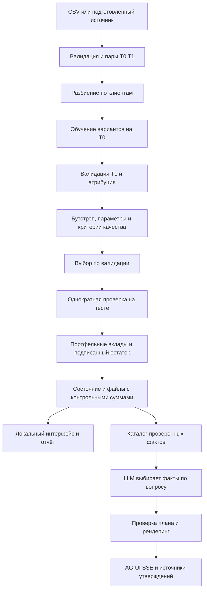

# Компоненты и поток анализа

Статус: Реализовано

LLM восстановлена по [ADR 0009](decisions/0009-complete-analysis-and-verified-llm.md). Выбранный провайдер — OpenRouter. Числа считает ядро; модель получает каталог агрегированных фактов, выбирает их порядок и детализацию, а не пишет непроверенные утверждения. Проверены SDK с подменённым HTTP-ответом и настоящая GPT-4.1 Mini: семь вопросов и браузерный AG-UI сценарий. [Результаты и обнаруженный отказ](../ml/llm-verification.md).

Рабочий экран и процесс расчёта закреплены за одной `stable_gam` по [ADR 0010](decisions/0010-single-gam.md). Все загрузки проходят три alpha и 20 повторов бутстрэпа. Параметр `thorough` сохраняется для совместимости запроса, но больше не меняет семью или полноту рабочей проверки. Семь прежних семейств остаются в исследовательском CLI.

## Компоненты

- `data/`: получение неизменённых источников, контроль суммы, чтение, подготовка пар и отдельный расчёт учебной цели. [Контракты данных](../data/README.md).
- `DatasetLoader`: проверка ключей, типов, конечности цели, обоих периодов и календарного порядка. Числовые пропуски факторов допускаются и заполняются только внутри обучаемого pipeline.
- `BenchmarkRunner`: порядок разбиения, поиска, диагностики, выбора и тестирования; тестовая цель не участвует в выборе. `ModelSearch` сохраняет каждый из трёх вариантов параметров, включая отказы.
- `CandidateFactory`: независимая подготовка признаков и модель. `ModelEvaluator` считает RMSE, MAE и остаток на отдельной группе клиентов.
- `PipelineAttributor`: разность непересекающихся основных и парных термов одной замороженной модели. `AttributionBootstrap` переобучает весь pipeline на выборках T0 с возвращением; состав валидации фиксирован.
- `QualityPolicy`: явные измерения, пороги и причины принятия, отказа или неполной проверки. [Основной контракт](decisions/0007-quality-and-numerical-checks.md).
- `ParameterStability`: сопоставляет вклады всех записанных профилей семьи на фиксированной валидации. Неполная или неустойчивая проверка исключает подтверждение надёжности до выбора модели.
- `DiagnosticRunner`: профиль произвольного CSV, перестановочная важность на валидации T1 и численная классификация условных сечений. Диагностики не меняют выбранную модель или тестовые метрики. [Метрики](../ml/metrics.md).
- `ExperimentWriter`: сохраняет модели, прогнозы, атрибуции, бутстрэп, условные сечения и завершающий манифест. `SectionBuilder` использует только опорные характеристики обучающей группы.
- `api/`: тонкие HTTP-адаптеры и менеджер одного отдельного процесса. Жизненный цикл приложения владеет наблюдением, отменой и завершением процесса. [ADR 0008](decisions/0008-local-dashboard.md).
- `EvidenceBuilder` и `FactChecker`: каталог фактов из валидного состояния, обязательные ограничения, ссылки, отказ при неизвестных/повторных идентификаторах или пропущенных предупреждениях. `InterpretationService` ограничивает время, число запросов и токены. Клиент OpenRouter создаётся и закрывается жизненным циклом приложения.

## Контракт результата

Основной машинный источник — [AnalysisState](../../src/ec_analysis/schemas/state.py). `scope` различает весь портфель, валидацию и тест. `attribution_checked` означает проверенную арифметику. `explanation_validated` дополнительно требует принятой валидации и теста; максимальная присваиваемая уверенность — `medium`. Иначе сохраняется `low` и причины отказа. [Метрики](../ml/metrics.md) объясняют знаменатели и численные допуски.

В `split.json` находятся идентификаторы клиентов и календарные границы. SHA-256 входа хранится в состоянии и манифесте; версии зависимостей, исходников и файлов — в манифесте. `calculation_ref` ссылается на конкретный CSV и колонку терма. База модели одинакова между периодами и сокращается при равном составе. Новые выдачи и выбывшие клиенты требуют отдельного правила; сейчас непарный вход отклоняется.

Дополнительные поля — [схемы диагностик](../../src/ec_analysis/schemas/diagnostics.py). `profile.json`, `global-importance.json`, `shapes.json` и `parameter-sensitivity-{model}.json` включаются в контрольные суммы. Старые состояния читаются с отсутствующими необязательными полями. `CheckedExplanation` содержит SHA-256 состояния, модель, проверенные абзацы и ссылки каждого утверждения.

## API и пользовательский сценарий

- `GET /` — экран; `GET /health` — готовность HTTP-сервиса.
- `GET /api/example` — локальный пример CSV.
- `POST /api/analyses?target=npv&thorough=false` — загрузка CSV телом запроса, ответ 202 с идентификатором.
- `GET /api/analyses/{id}` — ход выполнения; `DELETE` по тому же адресу — отмена.
- `GET /api/analyses/{id}/result` — проверенное состояние после завершения.
- `GET /api/analyses/{id}/files/{filename}` — только JSON/CSV из манифеста завершённого задания.
- `GET /benchmark` — прежний совместимый исследовательский расчёт трёх baseline; рабочий экран использует `/api/analyses`.
- `GET /api/llm/status` — наличие настройки и имя модели, без ключа.
- `POST /api/analyses/{id}/explain` — вопрос и завершённое серверное состояние; проверенное объяснение JSON.
- `POST /ag-ui` — `RunAgentInput` установленного `ag-ui-protocol`: `forwardedProps.analysisId`, последний текстовый вопрос `user`; клиентское `state` игнорируется. События: `RUN_STARTED` → после полной проверки `STATE_SNAPSHOT` → `TEXT_MESSAGE_START/CONTENT/END` → `RUN_FINISHED`. При отказе — `RUN_ERROR` без непроверенного текста.

Без настройки LLM маршруты объяснения возвращают 503. Неизвестный анализ — 404, незавершённый — 409, недопустимый запрос — 422. JSON-маршрут при ошибке провайдера/проверки возвращает 502; SSE сообщает безопасную ошибку событием. Используется собственный адаптер проверенных событий AG-UI: сырой поток библиотечного LLM-адаптера не публикуется.

Приложение рассчитано на один процесс Uvicorn и локального пользователя. Задания сохраняются в `data/jobs/`; менеджер HTTP-заданий живёт в памяти. После перезапуска файлы остаются доступны локально. Большие модели не выдаются по HTTP, произвольные пути не принимаются. В OpenRouter передаются вопрос и каталог агрегированных результатов с названиями факторов; исходные строки CSV и идентификаторы клиентов не передаются. Ограничения и команды — в [инструкции запуска](../development/README.md).
